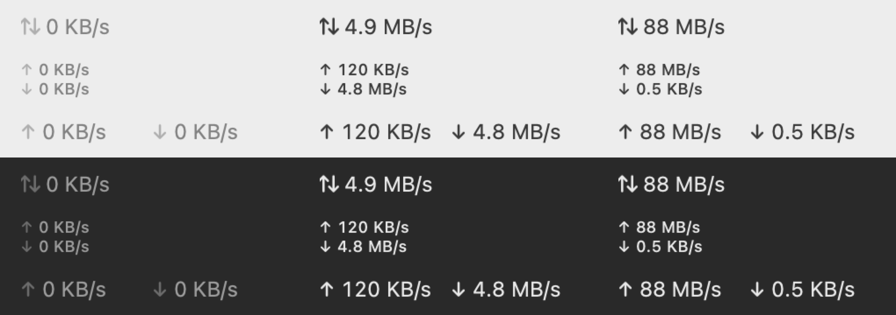

# Pulse

Live internet speed in the macOS menu bar: how fast data is moving through your Mac right now, updated every second.



macOS 14 or later, Apple Silicon and Intel. About 1% CPU, no Dock icon, no windows, no network access of its own.

[Русский](README.ru.md)

## Install

```sh
curl -fsSL https://raw.githubusercontent.com/guitvcer/pulse/main/install.sh | sh
```

It puts Pulse.app in Applications and starts it. Run the same command to update.

From source, with Xcode or the Command Line Tools: `git clone https://github.com/guitvcer/pulse && cd pulse && make install`.

## Use

Click the speed to pick a layout:

- **Stacked**: upload above download (default)
- **Inline**: both on one line
- **Compact**: one number, upload and download combined

The same menu has **Open at Login** and **Quit**. An arrow dims while nothing moves in its direction. The label keeps a fixed width, so other menu bar icons don't jump.

Units are decimal, like Finder: 1 MB/s is 1,000,000 bytes per second.

## Where the numbers come from

Pulse reads the byte counters macOS keeps for each network adapter and shows the difference every second. Only physical adapters count (Wi-Fi, Ethernet, iPhone tethering): VPN and virtual machine traffic already passes through them, so counting it again would double it. Pulse never runs speed tests and never uses your bandwidth.

## Uninstall

Turn off **Open at Login**, quit Pulse, delete Pulse.app from Applications.

## Status

Tested on one machine: MacBook Pro M4, macOS 27. Issues welcome.

## Development

`make check` runs the linter and tests. `make preview` draws every layout into `build/preview.png`. `make install` builds and launches the app. `git config core.hooksPath .githooks` runs the checks before each commit. Pushing a `v*` tag publishes a release.

## License

MIT
