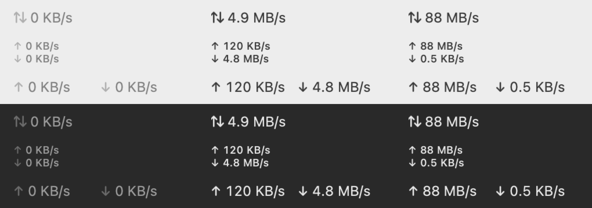

# Pulse

Скорость интернета в строке меню macOS: сколько данных проходит через Mac прямо сейчас, обновляется каждую секунду.



macOS 14 и новее, Apple Silicon и Intel. Около 1% процессора, без значка в Dock, без окон, сам в сеть не ходит.

## Установка

```sh
curl -fsSL https://raw.githubusercontent.com/guitvcer/pulse/main/install.sh | sh
```

Команда кладёт Pulse.app в «Программы» и запускает его. Для обновления выполните её ещё раз.

Из исходников, с Xcode или Command Line Tools: `git clone https://github.com/guitvcer/pulse && cd pulse && make install`.

## Как пользоваться

Нажмите на скорость и выберите вид:

- **Stacked**: отдача над загрузкой (по умолчанию)
- **Inline**: обе в одну строку
- **Compact**: одно число, отдача и загрузка вместе

В том же меню есть **Open at Login** (запуск при входе) и **Quit**. Стрелка тускнеет, пока в её сторону ничего не идёт. Ширина надписи постоянная, поэтому соседние значки не прыгают.

Единицы десятичные, как в Finder: 1 MB/s — это 1 000 000 байт в секунду.

## Откуда цифры

Pulse читает счётчики байтов, которые macOS ведёт для каждого сетевого адаптера, и раз в секунду показывает разницу. Учитываются только физические адаптеры (Wi-Fi, Ethernet, раздача с iPhone): трафик VPN и виртуальных машин и так идёт через них, и второй раз его считать нельзя. Pulse не запускает тесты скорости и не тратит ваш трафик.

## Удаление

Выключите **Open at Login**, закройте Pulse, удалите Pulse.app из «Программ».

## Статус

Проверено на одной машине: MacBook Pro M4, macOS 27. Сообщения о проблемах приветствуются.

## Разработка

`make check` запускает линтер и тесты. `make preview` рисует все виды в `build/preview.png`. `make install` собирает и запускает приложение. `git config core.hooksPath .githooks` включает проверки перед каждым коммитом. Пуш тега `v*` публикует релиз.

## Лицензия

MIT
